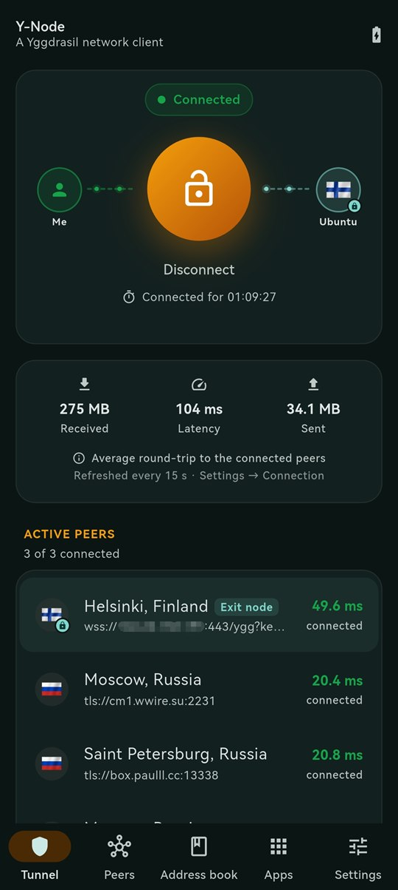
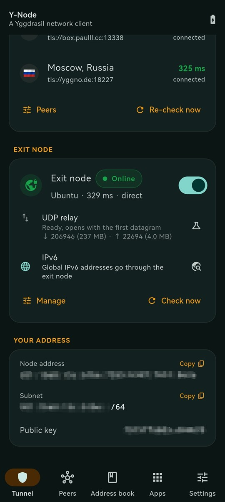
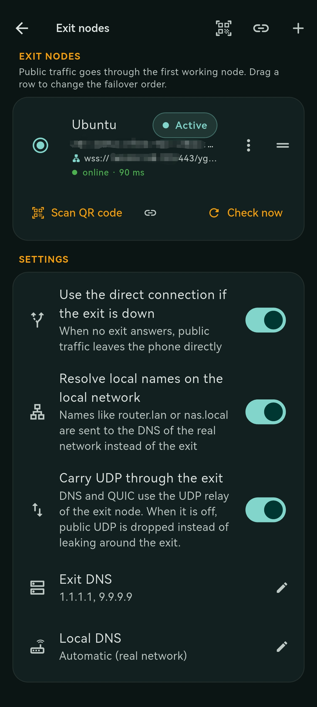
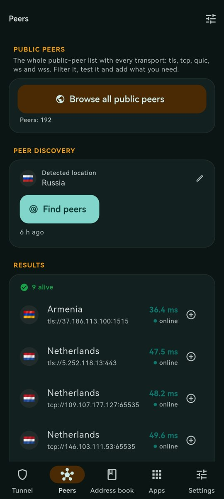
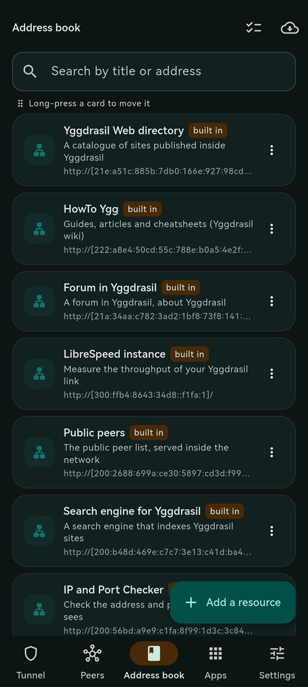
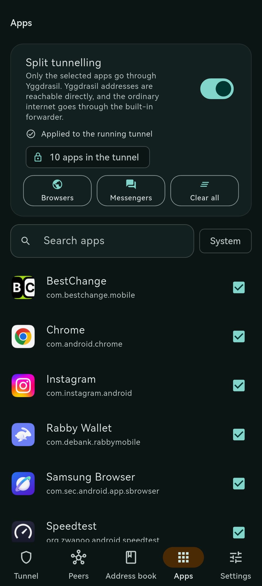
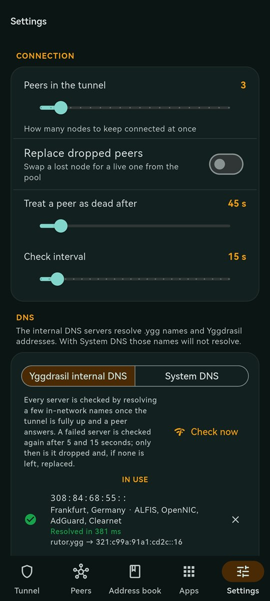
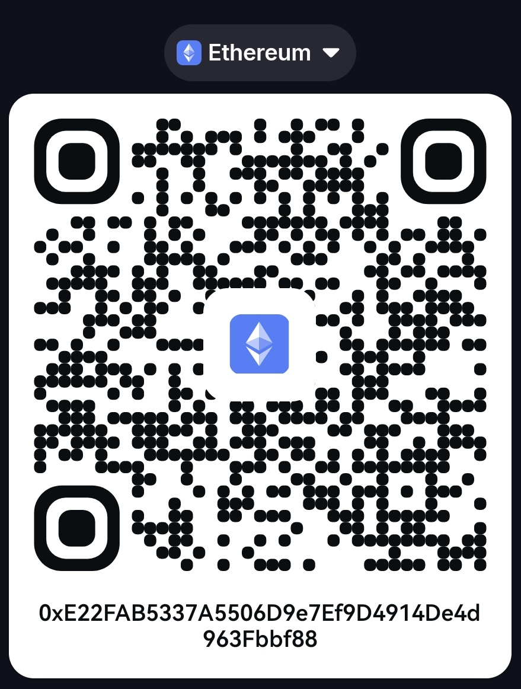
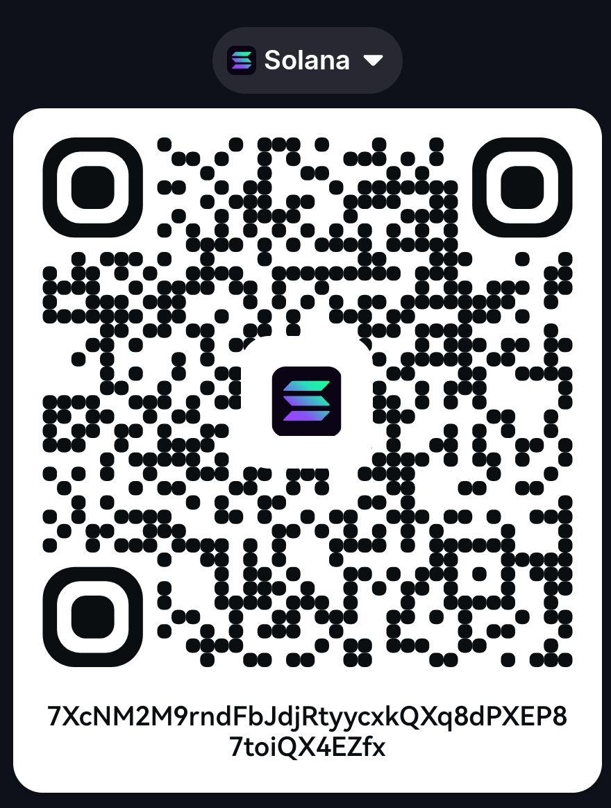
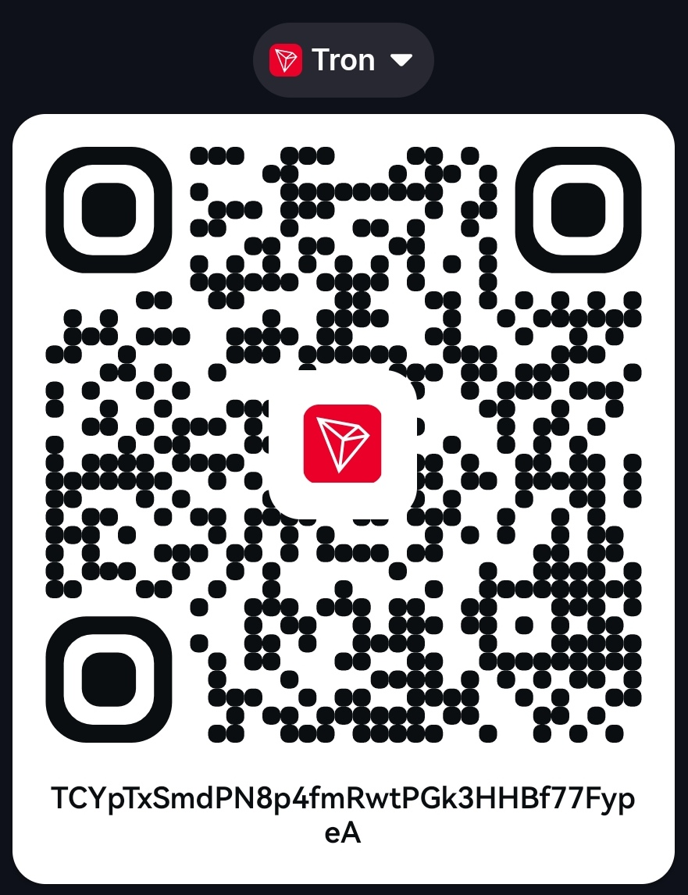

# Y-Node

**English** · [Русский](README.ru.md)

**Y-Node** is a Yggdrasil network client for Android. The app runs the Yggdrasil network stack and provides access to IPv6 resources of the distributed network through Android's system VPN interface.

## About the Yggdrasil network

[Yggdrasil](https://yggdrasil-network.github.io/) is a decentralized IPv6 overlay network with routing between nodes. Participants connect to each other through peering connections that can run over a local network or the Internet. Nodes forward traffic, and routes between them are built automatically.

Traffic inside Yggdrasil is end-to-end encrypted: intermediate nodes forward packets but cannot read their contents. Nodes are identified by a cryptographic key; a node's IPv6 address is derived from its identifier.

Yggdrasil is not an anonymity network and does not by itself provide access to the regular Internet. Accessing public Internet resources through Yggdrasil requires a separate gateway — an **Exit Node**.

Learn more about the architecture and principles: [official Yggdrasil documentation](https://yggdrasil-network.github.io/).

## About the app

Y-Node simplifies connecting an Android device to Yggdrasil and managing network traffic. The app uses Android's VPN API to route selected traffic through a virtual interface.

To access the regular Internet through Yggdrasil, Y-Node supports **[X-Node](https://github.com/MrKsey/x-node)** servers. X-Node is deployed on Ubuntu and provides client connections via a QR code. Y-Node imports connection parameters from such a QR code.

```text
Yggdrasil resources only, no exit node

┌───────────────────┐      ┌────────────────┐      ┌─────────────────────────┐
│    Android apps   │      │     Y-Node     │      │    Yggdrasil network    │
│ browser, Telegram │ ───► │ VPN interface  │ ───► │ sites and services .ygg │
│ other apps        │ ◄─── │ Yggdrasil node │ ◄─── │ addresses 200::/7       │
└───────────────────┘      └────────────────┘      └─────────────────────────┘

Regular Internet, through the exit node

┌───────────────────┐      ┌────────────────┐      ┌────────────────────┐      ┌──────────────┐
│    Android apps   │      │     Y-Node     │      │ X-Node (Exit Node) │      │   Internet   │
│ browser, Telegram │ ───► │ VPN interface  │ ───► │ SOCKS5             │ ───► │ sites        │
│ other apps        │ ◄─── │ Yggdrasil node │ ◄─── │ quotas, allowlist  │ ◄─── │ and services │
└───────────────────┘      └────────────────┘      └────────────────────┘      └──────────────┘
```

Without an exit node the app only gives access to Yggdrasil resources, and regular traffic goes directly through the phone's own network. With an exit node it travels over Yggdrasil to X-Node and leaves for the Internet from there.

<p align="center">
  &nbsp;&nbsp;&nbsp;
  &nbsp;&nbsp;&nbsp;
  &nbsp;&nbsp;&nbsp;
  
</p>

<p align="center">
  &nbsp;&nbsp;&nbsp;
  &nbsp;&nbsp;&nbsp;
  
</p>

## Key features

- **Connecting to Yggdrasil.** Start and stop the network tunnel from the app. Once connected, IPv6 addresses, sites and services hosted in Yggdrasil become available.
- **Automatic public peer selection.** The app downloads a list of public nodes, measures latency and suggests suitable peers for connection.
- **Connection health monitoring.** A supervisor tracks the availability and quality of the peers in use and replaces unavailable or noticeably slower nodes from the available pool when needed.
- **Exit Node connection.** Import an X-Node profile via QR code or a link, or add it as a plain SOCKS5 proxy with just the Yggdrasil address and port. Profiles support automatic failover; the connection to the Exit Node is direct, in a single hop. A SOCKS5-only profile is marked in the card and can be upgraded with an API token or an invite later.
- **IPv6 routing.** Global IPv6 traffic can be routed through the Exit Node while Yggdrasil service ranges stay inside the overlay network. The exit reports whether its own provider really routes IPv6: when the address exists but nothing answers, the app stops sending IPv6 traffic instead of letting it time out, and the card says why. The app also includes an IPv6 reachability check through the gateway.
- **UDP and QUIC support.** UDP traffic, including DNS and applications using QUIC, is also routed through the Exit Node.
- **Exit Node limits.** Display of traffic usage and information about speed limits or quotas when set by the server.
- **Per-app routing.** You can choose which Android apps use the VPN tunnel and which keep working directly. Search and ready-made app presets are available.
- **DNS.** Resolution of internal `.ygg` names; for regular domain names you can use the system DNS or specified DNS servers. An exit node that runs the Alfis resolver reports it through its status API: the server appears under **Settings → DNS → Available servers** as **DNS from exit node**, and the **DNS exit node** switch in the Exit node settings puts it in use. The switch stores the choice even before the resolver is known; while it is on, the entry is locked in the list and managed by that switch.
- **Address book.** A catalogue of Yggdrasil resources with search, the ability to add your own addresses and open them in a browser.

## Installation

1. Download the APK from the [latest releases](https://github.com/MrKsey/y-node/releases/latest).
2. Choose the build for your device architecture:
   - `arm64-v8a` — most modern Android devices;
   - `armeabi-v7a` — devices with a 32-bit ARM architecture.
3. Install the APK. If prompted, allow installing apps from the selected source in Android settings.
4. Launch Y-Node. On first launch, the wizard checks public peers and offers to add suitable nodes.
5. Tap **"Connect"** and confirm the VPN connection creation using Android tools.

To access only internal Yggdrasil resources, it is enough to configure a connection to peers. To route regular Internet traffic, you will additionally need an Exit Node profile, for example from X-Node.

## Building from source

The build runs on Linux. Go, JDK 17, Flutter, the Android SDK and the Android NDK are required.

Configure the environment variables with the actual paths and installed NDK version:

```bash
export ANDROID_HOME="$HOME/Android/Sdk"
export ANDROID_NDK_HOME="$ANDROID_HOME/ndk/<version>"
export JAVA_HOME="/usr/lib/jvm/java-17-openjdk-amd64"
export PATH="$JAVA_HOME/bin:$(go env GOPATH)/bin:$PATH"
```

### 1. Build the Go library for Android

```bash
go install golang.org/x/mobile/cmd/gomobile@latest

mkdir -p android/app/libs
cd go-bridge

gomobile init
gomobile bind   -target=android/arm,android/arm64   -androidapi=26   -ldflags=-checklinkname=0   -o ../android/app/libs/yggnode.aar   ./yggnode

cd ..
```

### 2. Build the APK

```bash
flutter pub get

flutter build apk   --release   --target-platform android-arm,android-arm64   --split-per-abi
```

The finished APK files will be in:

```text
build/app/outputs/flutter-apk/
```

## Donations

You can support the project with a donation to any of the wallets below.

<table>
  <tr>
    <td align="center">
      <br>
      <b>Bitcoin</b><br>
      <code>bc1qdf9wryj6tnyyr7ed4dkfv03nn0dxjf27xshfcr</code>
    </td>
    <td align="center">
      <br>
      <b>Ethereum</b><br>
      <code>0xE22FAB5337A5506D9e7Ef9D4914De4d963Fbbf88</code>
    </td>
  </tr>
  <tr>
    <td align="center">
      <br>
      <b>Solana</b><br>
      <code>7XcNM2M9rndFbJdjRtyycxkQXq8dPXEP87toiQX4EZfx</code>
    </td>
    <td align="center">
      <br>
      <b>Tron</b><br>
      <code>TCYpTxSmdPN8p4fmRwtPGk3HHBf77FypeA</code>
    </td>
  </tr>
</table>

## License

The project is distributed under the [MIT](LICENSE) license.
