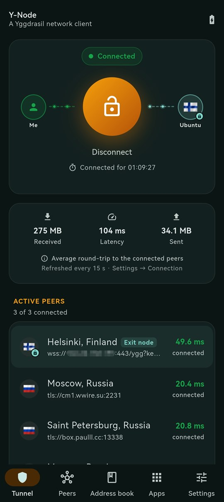
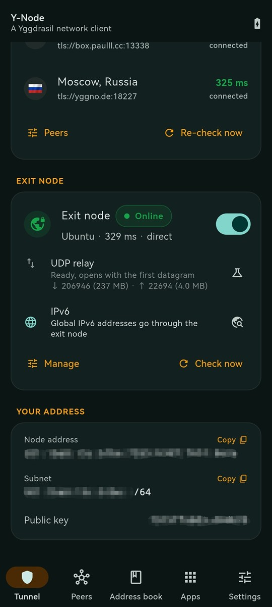
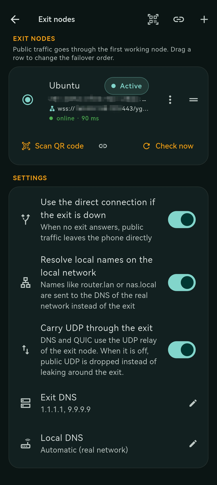
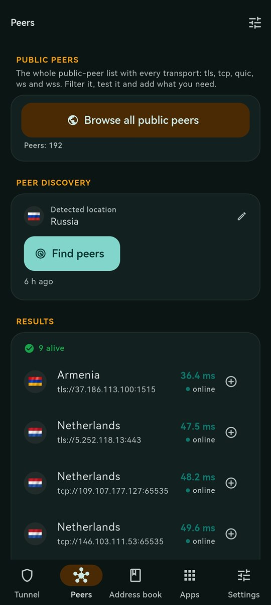
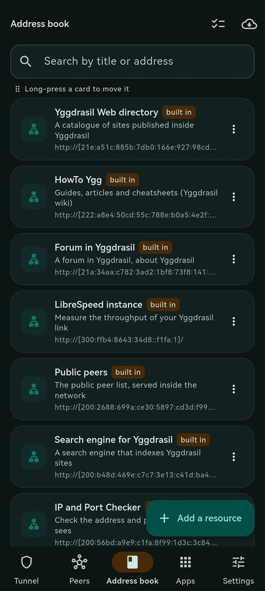
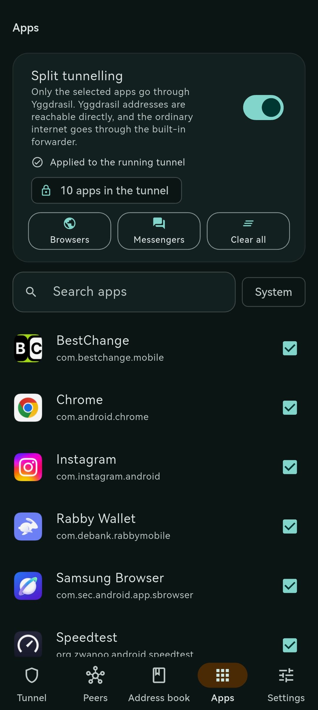
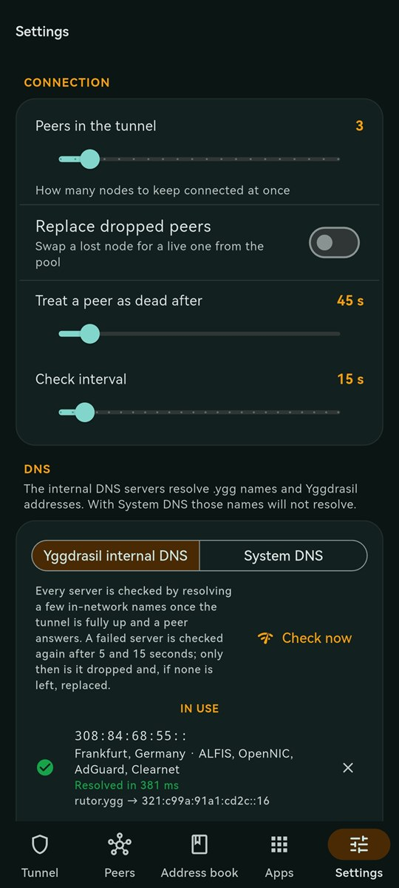

# Y-Node

[English](README.md) · **Русский**

**Y-Node** — клиент сети Yggdrasil для Android. Приложение запускает сетевой стек Yggdrasil и предоставляет доступ к IPv6-ресурсам распределённой сети через системный VPN-интерфейс Android.

## О сети Yggdrasil

[Yggdrasil](https://yggdrasil-network.github.io/) — децентрализованная IPv6 overlay-сеть с маршрутизацией между узлами. Участники соединяются друг с другом через peering-соединения, которые могут работать поверх локальной сети или Интернета. Узлы пересылают трафик, а маршруты между ними формируются автоматически.

Трафик внутри Yggdrasil шифруется сквозным образом: промежуточные узлы пересылают пакеты, но не могут прочитать их содержимое. Для идентификации узлов используется криптографический ключ; IPv6-адрес узла связан с его идентификатором.

Yggdrasil не является анонимной сетью и сама по себе не предоставляет выход в обычный Интернет. Для доступа к публичным интернет-ресурсам через Yggdrasil требуется отдельный шлюз — **Exit Node**.

Подробнее об архитектуре и принципах работы: [официальная документация Yggdrasil](https://yggdrasil-network.github.io/).

## О приложении

Y-Node упрощает подключение Android-устройства к Yggdrasil и управление сетевым трафиком. Приложение использует VPN API Android для маршрутизации выбранного трафика через виртуальный интерфейс.

Для выхода в обычный Интернет через Yggdrasil Y-Node поддерживает серверы **[X-Node](https://github.com/MrKsey/x-node)**. X-Node разворачивается на Ubuntu и предоставляет подключение клиентов с помощью QR-кода. Y-Node импортирует параметры подключения из такого QR-кода.

```text
Только ресурсы Yggdrasil, без Exit Node

┌────────────────────┐      ┌────────────────┐      ┌──────────────────────┐
│ Приложения Android │      │     Y-Node     │      │    Сеть Yggdrasil    │
│ браузер, Telegram  │ ───► │ VPN-интерфейс  │ ───► │ сайты и сервисы .ygg │
│ другие приложения  │ ◄─── │ узел Yggdrasil │ ◄─── │ адреса 200::/7       │
└────────────────────┘      └────────────────┘      └──────────────────────┘

Обычный Интернет, через Exit Node

┌────────────────────┐      ┌────────────────┐      ┌────────────────────┐      ┌───────────┐
│ Приложения Android │      │     Y-Node     │      │ X-Node (Exit Node) │      │  Интернет │
│ браузер, Telegram  │ ───► │ VPN-интерфейс  │ ───► │ SOCKS5             │ ───► │ сайты     │
│ другие приложения  │ ◄─── │ узел Yggdrasil │ ◄─── │ квоты, allowlist   │ ◄─── │ и сервисы │
└────────────────────┘      └────────────────┘      └────────────────────┘      └───────────┘
```

Без Exit Node приложение даёт доступ только к ресурсам Yggdrasil, а обычный трафик идёт напрямую через сеть телефона. С Exit Node он проходит по сети Yggdrasil до X-Node и уже оттуда выходит в Интернет.

<p align="center">
  &nbsp;&nbsp;&nbsp;
  &nbsp;&nbsp;&nbsp;
  &nbsp;&nbsp;&nbsp;
  
</p>

<p align="center">
  &nbsp;&nbsp;&nbsp;
  &nbsp;&nbsp;&nbsp;
  
</p>

## Основные возможности

- **Подключение к Yggdrasil.** Запуск и остановка сетевого туннеля из приложения. После подключения доступны IPv6-адреса, сайты и сервисы, размещённые в Yggdrasil.
- **Автоматический подбор публичных пиров.** Приложение загружает список публичных узлов, проверяет задержку и предлагает подходящие пиры для подключения.
- **Контроль состояния соединений.** Супервизор отслеживает доступность и качество используемых пиров и при необходимости заменяет недоступные или заметно замедлившиеся узлы из доступного пула.
- **Подключение к Exit Node.** Импорт профиля X-Node по QR-коду и маршрутизация обычного интернет-трафика через выбранный шлюз. Для профилей предусмотрено автоматическое переключение при сбое; подключение к Exit Node выполняется напрямую, в один переход.
- **Маршрутизация IPv6.** Глобальный IPv6-трафик может направляться через Exit Node, а служебные диапазоны Yggdrasil остаются внутри overlay-сети. В приложении предусмотрена проверка доступности IPv6 через шлюз.
- **Поддержка UDP и QUIC.** UDP-трафик, включая DNS и приложения, использующие QUIC, также маршрутизируется через Exit Node.
- **Учёт ограничений Exit Node.** Отображение расхода трафика и информации об ограничениях скорости или квотах, если они заданы сервером.
- **Раздельная маршрутизация приложений.** Можно указать, какие Android-приложения используют VPN-туннель, а какие продолжают работать напрямую. Доступны поиск и готовые наборы приложений.
- **DNS.** Разрешение внутренних имён `.ygg`; для обычных доменных имён можно использовать системный DNS или указанные DNS-серверы.
- **Адресная книга.** Каталог ресурсов Yggdrasil с поиском, возможностью добавлять собственные адреса и открывать их в браузере.

## Установка

1. Скачайте APK из раздела [последних релизов](https://github.com/MrKsey/y-node/releases/latest).
2. Выберите сборку для архитектуры устройства:
   - `arm64-v8a` — большинство современных Android-устройств;
   - `armeabi-v7a` — устройства с 32-битной ARM-архитектурой.
3. Установите APK. При необходимости разрешите установку приложений из выбранного источника в настройках Android.
4. Запустите Y-Node. При первом запуске мастер проверит публичные пиры и предложит добавить подходящие узлы.
5. Нажмите **«Подключить»** и подтвердите создание VPN-подключения средствами Android.

Для доступа только к внутренним ресурсам Yggdrasil достаточно настроить подключение к пирам. Для маршрутизации обычного интернет-трафика дополнительно потребуется профиль Exit Node, например от X-Node.

## Сборка из исходного кода

Сборка выполняется в Linux. Необходимы Go, JDK 17, Flutter, Android SDK и Android NDK.

Настройте переменные окружения, указав фактические пути и установленную версию NDK:

```bash
export ANDROID_HOME="$HOME/Android/Sdk"
export ANDROID_NDK_HOME="$ANDROID_HOME/ndk/<версия>"
export JAVA_HOME="/usr/lib/jvm/java-17-openjdk-amd64"
export PATH="$JAVA_HOME/bin:$(go env GOPATH)/bin:$PATH"
```

### 1. Сборка Go-библиотеки для Android

```bash
go install golang.org/x/mobile/cmd/gomobile@latest

mkdir -p android/app/libs
cd go-bridge

gomobile init
gomobile bind   -target=android/arm,android/arm64   -androidapi=26   -ldflags=-checklinkname=0   -o ../android/app/libs/yggnode.aar   ./yggnode

cd ..
```

### 2. Сборка APK

```bash
flutter pub get

flutter build apk   --release   --target-platform android-arm,android-arm64   --split-per-abi
```

Готовые APK-файлы будут находиться в каталоге:

```text
build/app/outputs/flutter-apk/
```

## Донаты

Поддержать проект можно донатом на любой из кошельков ниже.

<table>
  <tr>
    <td align="center">
      <br>
      <b>Bitcoin</b><br>
      <code>bc1qdf9wryj6tnyyr7ed4dkfv03nn0dxjf27xshfcr</code>
    </td>
    <td align="center">
      <br>
      <b>Ethereum</b><br>
      <code>0xE22FAB5337A5506D9e7Ef9D4914De4d963Fbbf88</code>
    </td>
  </tr>
  <tr>
    <td align="center">
      <br>
      <b>Solana</b><br>
      <code>7XcNM2M9rndFbJdjRtyycxkQXq8dPXEP87toiQX4EZfx</code>
    </td>
    <td align="center">
      <br>
      <b>Tron</b><br>
      <code>TCYpTxSmdPN8p4fmRwtPGk3HHBf77FypeA</code>
    </td>
  </tr>
</table>

## Лицензия

Проект распространяется под лицензией [MIT](LICENSE).
